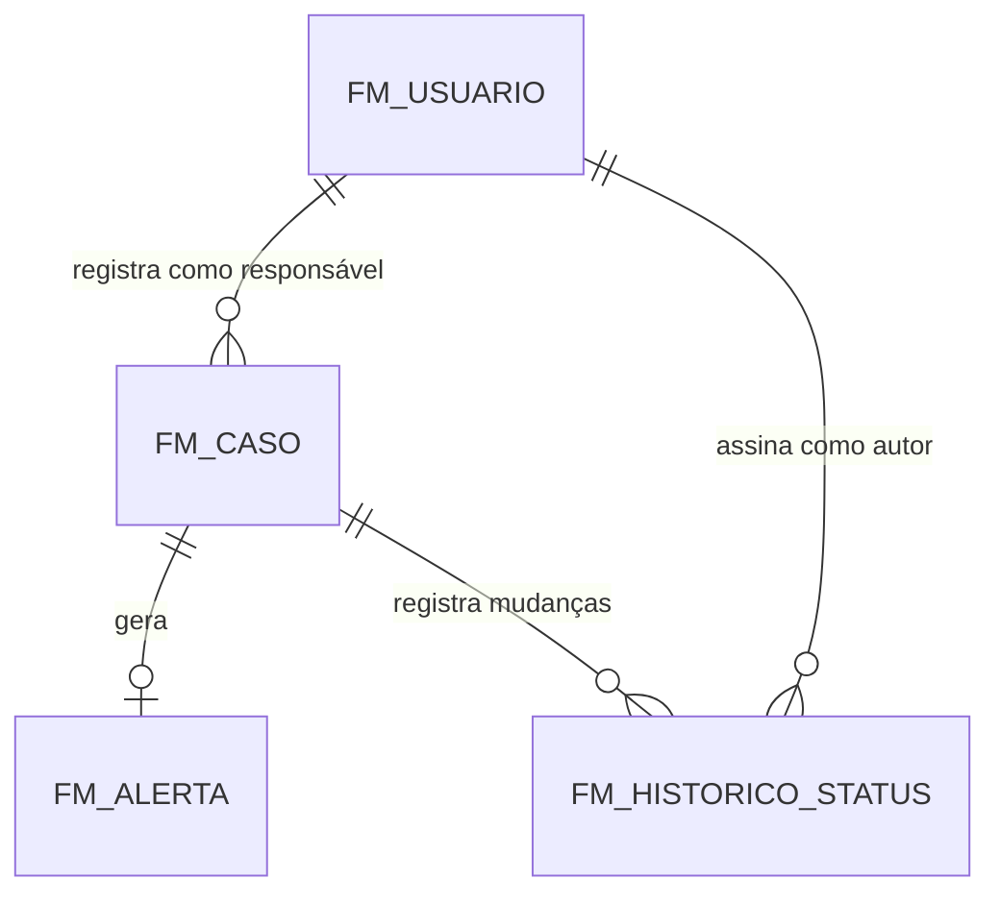

# Find Me | Database

**FIAP · Global Solution 2026/2 · Mastering Relational and Non-Relational Database**

O Find Me ajuda a divulgar com responsabilidade casos de desaparecimento de crianças e adolescentes. Um responsável registra o caso, a equipe interna valida as informações e um moderador autoriza o alerta. Ao registrar a localização, o sistema retira o alerta ativo e mantém o histórico da decisão. Para situações reais, o Find Me complementa os canais oficiais.

## Integrantes

| Nome | RM | Turma |
| --- | --- | --- |
| Caio Cantini Couto | informado no Portal FIAP | 2TDSPS |
| Guilherme Pinto Eustáquio | informado no Portal FIAP | 2TDSPS |
| Matheus Tavares | informado no Portal FIAP | 2TDSPS |

## Modelo Oracle

| Tabela | Registros iniciais | Papel |
| --- | ---: | --- |
| `FM_USUARIO` | 14 | Responsáveis, colaboradores e moderadores fictícios |
| `FM_CASO` | 12 | Casos vinculados a um responsável, com idade entre 0 e 17 anos |
| `FM_ALERTA` | 10 | Conteúdo autorizado para divulgação. A chave única limita a um alerta por caso |
| `FM_HISTORICO_STATUS` | 37 | Criação e mudanças de status com autor e data |

O modelo usa como referência `Usuario`, `Caso`, `Alerta`, os papéis e os estados da API Java da equipe. A trilha de auditoria, registrada em log no Java, é uma tabela nessa entrega. A API Java mantém sua configuração H2. O trabalho em Oracle pode ser executado no schema acadêmico independentemente da API. O papel validado pelo procedimento é o do autor informado em um schema de demonstração. Em produção, a aplicação precisaria vincular esse ID à identidade autenticada e restringir as permissões de execução.

[Repositório Java de referência](https://github.com/caioccouto/FindMe-GlobalSolution/tree/8e0b95963086524d539e476ae9d643f08ccc5e08)

## Regras implementadas

1. A fila interna indica `REVISAR_CADASTRO` para um caso `EM_ANALISE`, `PREPARAR_DIVULGACAO` para um caso `VALIDADO` e `FORA_DA_FILA_DE_PUBLICACAO` para os demais. A classificação organiza o próximo trabalho da equipe.
2. Apenas um moderador identificado pode acionar `PUBLICAR` para um caso `VALIDADO`. O procedimento exige título e descrição pública e cria ou atualiza o único registro de alerta daquele caso.
3. `LOCALIZAR` exige um caso `PUBLICADO` ou `EM_ACOMPANHAMENTO` e um alerta ativo. A operação muda o status para `LOCALIZADO`, desativa o alerta e grava o histórico.
4. A operação bloqueia o caso até o fim da transação e deixa a confirmação a cargo do chamador. Em caso de erro, desfaz as mudanças da operação. A consulta lista apenas alertas ativos de casos publicados ou em acompanhamento.

## Executar

Para executar, o schema precisa das permissões `CREATE TABLE`, `CREATE SEQUENCE` e `CREATE PROCEDURE`, além de quota de armazenamento. Use um schema de teste sem as tabelas `FM_*` desta entrega.

- **SQL Developer** — descompacte o projeto, abra `executar.sql` na conexão Oracle e execute com **F5 (Executar Script)**. Mantenha a pasta `sql/` ao lado do arquivo.
- **SQLcl ou SQL*Plus** — conecte-se ao schema, abra a sessão na pasta desta entrega e digite `@executar.sql`.

O script cria as tabelas, carrega a amostra, compila os procedimentos, confere erros de compilação, conta os registros e executa os blocos. A pasta de execução recebe `findme_database_execucao.log`. Para repetir apenas a demonstração depois da instalação, rode `SET SERVEROUTPUT ON` e `@sql/04_blocos.sql`. A demonstração termina com rollback para preservar a carga inicial.

## Roteiro de demonstração

| Etapa | O que conferir |
| --- | --- |
| Modelo e carga | Quatro tabelas relacionadas com 14, 12, 10 e 37 registros |
| Bloco 1 | Variáveis, `SELECT INTO`, `DBMS_OUTPUT`, `IF/ELSIF/ELSE` e `FOR`. Os casos 5, 11 e 12 passam pelos três ramos |
| Bloco 2, bloqueios | Colaborador recebe `ORA-20002`. Publicação sem validação recebe `ORA-20004` |
| Bloco 2, operação | Caso 12 passa de `VALIDADO` a `PUBLICADO`, com um alerta ativo |
| Consulta com cursor explícito | `FM_LISTAR_ALERTAS_ATIVOS` usa `OPEN`, `FETCH`, `EXIT WHEN %NOTFOUND` e `CLOSE`. Lista 9 alertas após a publicação |
| Localização e auditoria | Caso 12 fica `LOCALIZADO` com zero alertas ativos e quatro eventos de histórico. Total da consulta volta a 8 |

A instalação e a demonstração foram executadas em um schema limpo no Oracle AI Database 26ai Free (23.26.4.0.0), com SQL*Plus. A pasta [evidencias](evidencias/) contém o log integral da execução.

## Uso de IA generativa

ChatGPT foi utilizado no desenvolvimento dos scripts, da massa fictícia, dos testes e do README.
